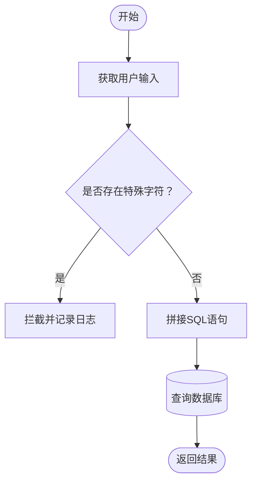

# Markdown 学习笔记

## 1.标题

Ctrl + 1 ：设为一级标题

Ctrl + 2 ：设为二级标题

Ctrl + 3 ：设为三级标题

Ctrl + 4 ：设为四级标题

Ctrl + 5 ：设为五级标题

Ctrl + 6  ：设为六级标题

## 2.代码块

Ctrl + Shift + K ：插入代码块👇

```python
print("Hello,world!") # O(1)
```

Ctrl + Shift + ` ：插入短小代码块👇

`echo kali`

## 3.表格

Ctrl + T ： 召唤表格👇

| +    | /    | （   | ）   |
| ---- | ---- | ---- | ---- |
| K    | *    |      |      |
|      |      |      |      |
|      |      |      |      |

## 4.图表

使用```mermaid 唤出 图表

网络攻击可视化




$$

$$


