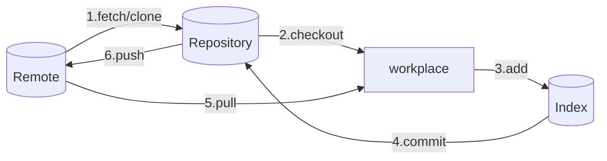

# Git学习笔记

## 1.Git基本概念

git是一个开源的分布式版本控制系统,可以有效、高速地处理从很小到非常大的项目版本管理。Git是Linus
Torvalds 为了帮助管理 Linux 内核开发而开发的一个开放源码的版本控制软件。

**简单说是多个程序员共享一个版本库**

## 2.Git工作流程

*Remote:远程仓库*	*Repository:本地仓库*	*Index:暂存区*	*workspace:工作区*

## 3.Git常用命令

1.clone(克隆):从远程仓库中克隆代码到本地仓库

2.checkout(检出):从本地仓库中检出一个仓库分支然后进行修订

3.add(添加):在提交前先将代码提交到暂存区

4.commit(提交【我更喜欢叫”投入“】 ):提交到本地仓库。本地仓库中保存修改的各个历史版本

5.fetch(抓取):从远程库,抓取到本地仓库,不进行任何的合并动作,一般操作比较少。

6.pull(拉取):从远程库拉到本地库,自动进行合并(merge),然后放到到工作区,相当于fetch+merge

7.push(推送):修改完成后,需要和团队成员共享代码时,将代码推送到远程仓库

## 4.My way to learn git

1.配置git

git config --global ...

2.创建 ~/.bashrc

必须建在家目录下👇

内容如下

3.创建初始文件夹

4.创建hello.md

使用add 与 commit 看看状态

